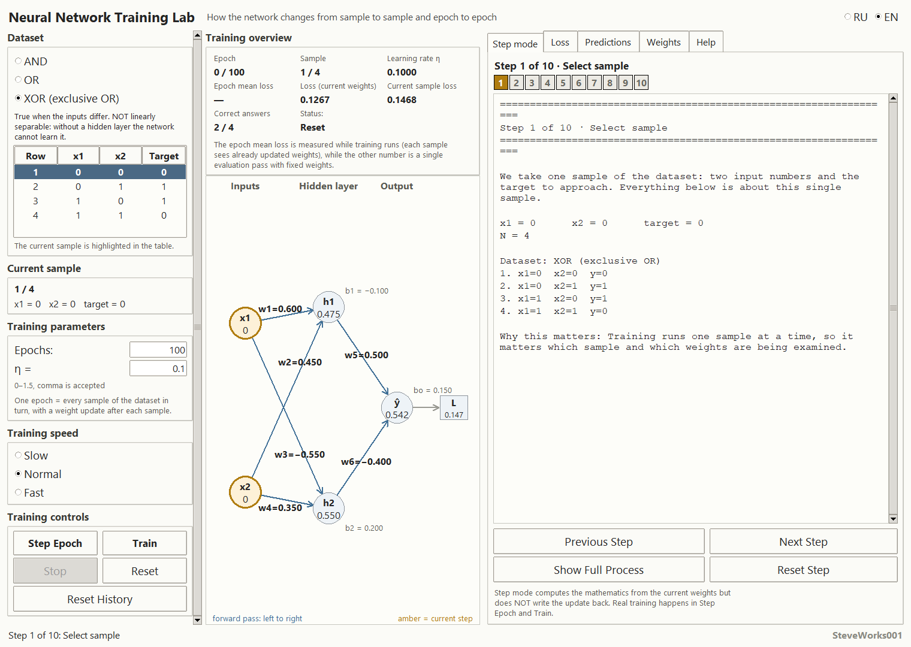
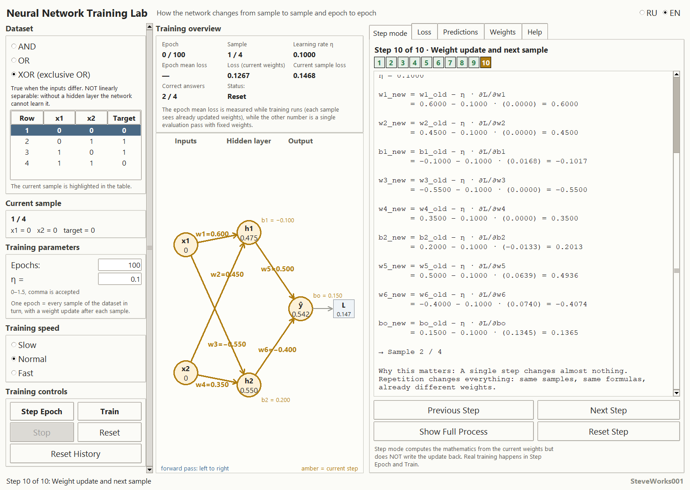
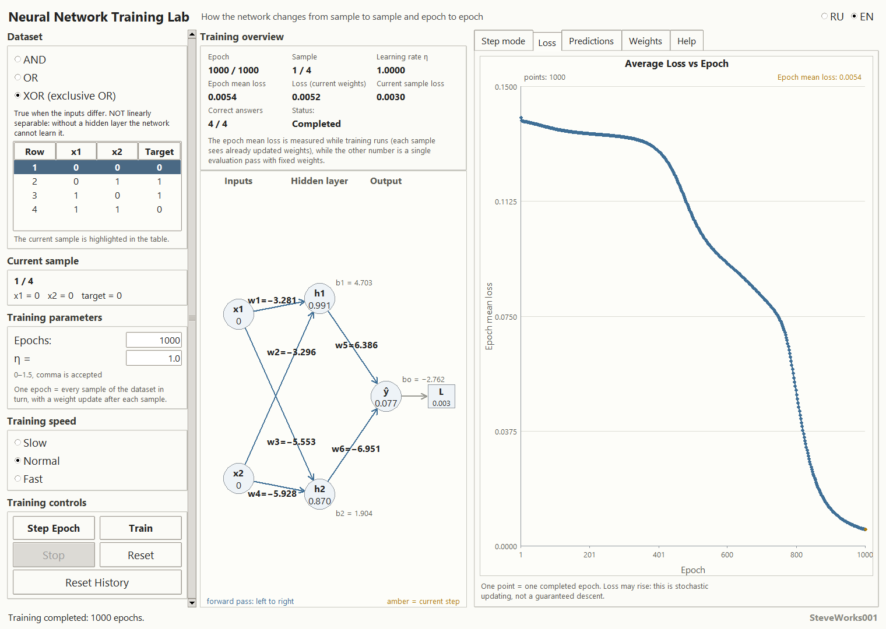
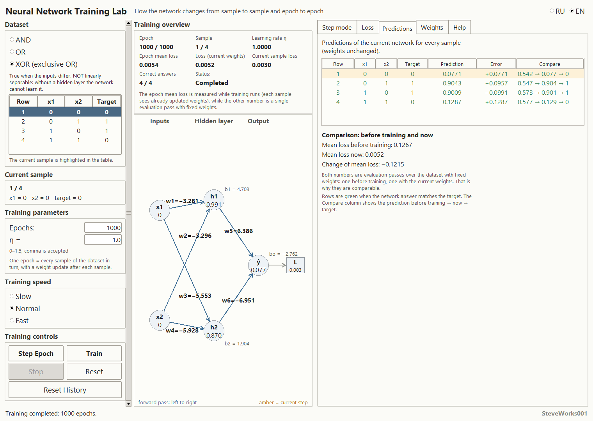
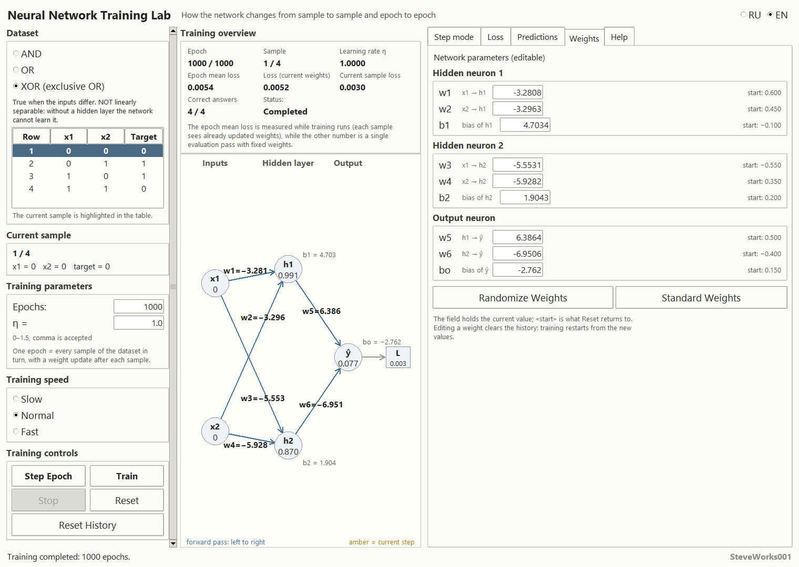
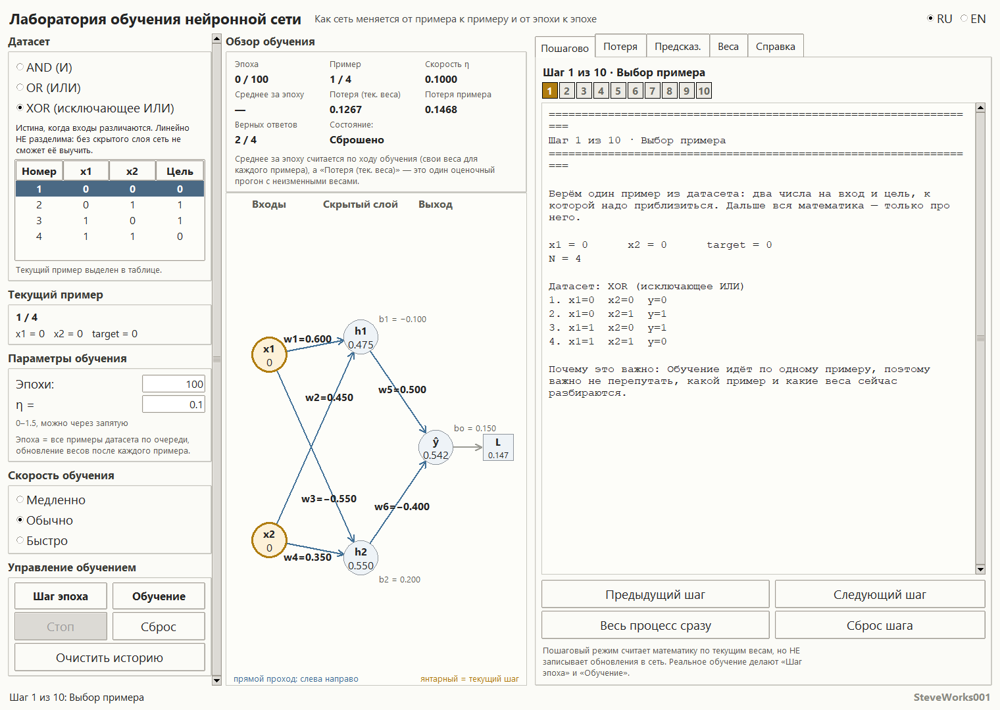
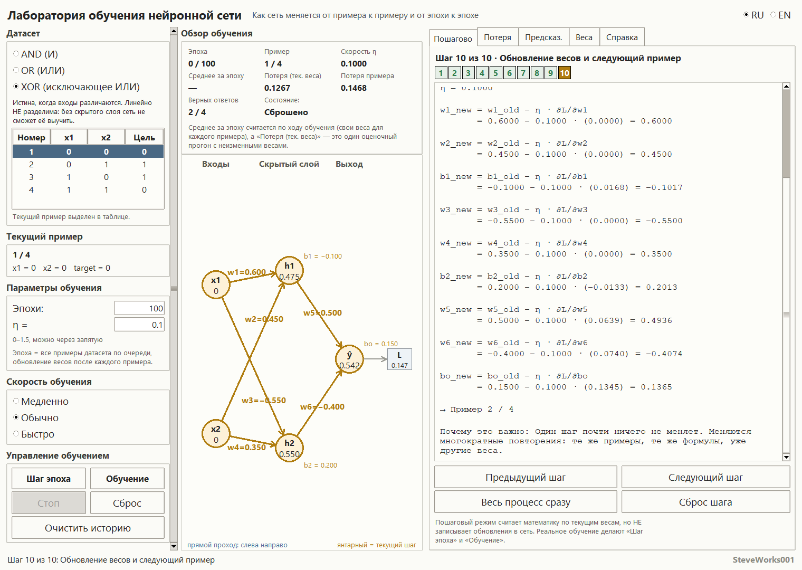
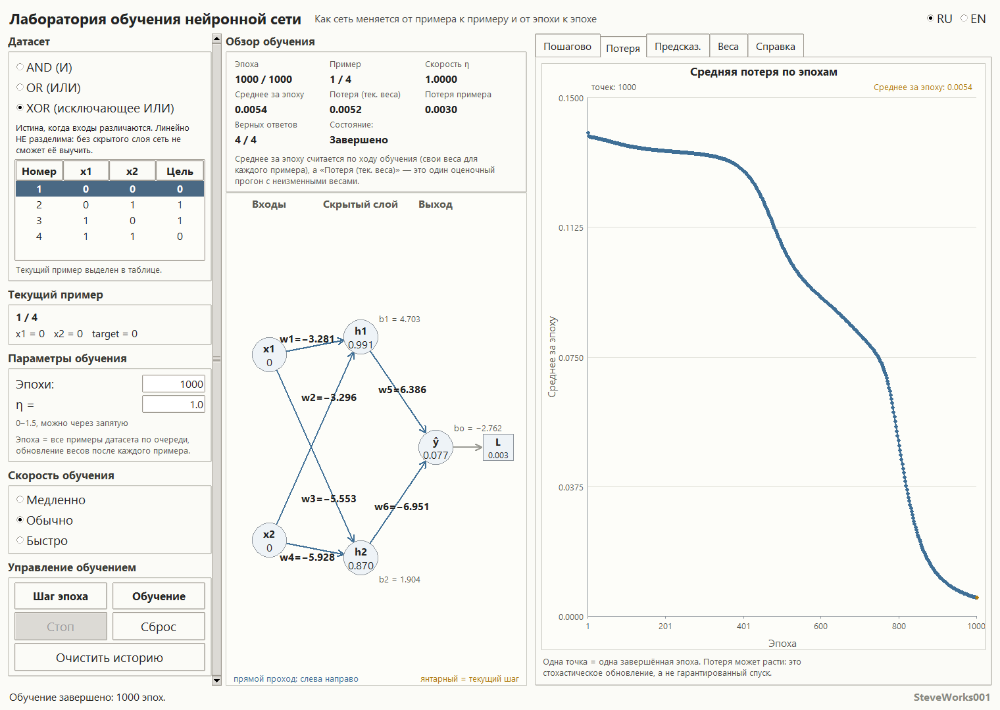
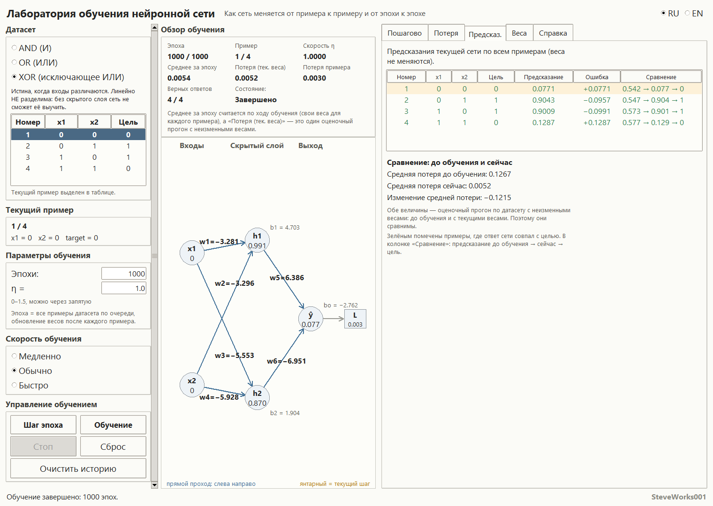
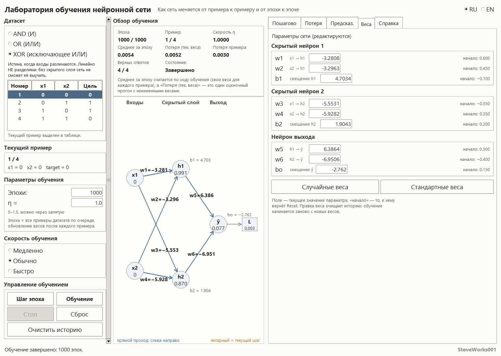

# Neural Network Training Lab

Project 6 of 13 in the educational neural-network simulator series.
A single-file Python and Tkinter application: standard library only, no
external packages, no network access, nothing to install. The same training
cycle — "forward pass → loss → backward pass → update" — is shown here in three
forms at once: as numbers on screen, as a ten-step breakdown of one sample, and
as a per-epoch mean-loss graph.

---

## Purpose

Show exactly how the weights of a neural network change when training repeats
— with no magic and no "black box". Every step is visible: which number came
from where, which formula produced it, and how it affects the next step.

The previous project in the series takes a single training step apart down to
one digit. Here that same step becomes a loop: four samples, four updates, one
graph point, then a hundred more epochs of the same — and the screen shows what
came of it.

A second goal is to teach the difference between quantities that are often
confused: the loss of one sample, the mean loss accumulated while an epoch
runs, and the loss of a single evaluation pass with fixed weights. "Before" and
"after" can only be compared through that last one, and the app says so on
screen.

### What this project does not contain

- no configurable model: the 2 → 2 → 1 architecture, the sigmoid and the
  quadratic loss are fixed — another layer or another loss function cannot be
  set up;
- no data of your own: three ready-made tables of four samples each, no dataset
  is loaded or added;
- no other optimisers: sequential gradient descent only, no mini-batches, no
  momentum, no adaptive learning rates, no regularisation;
- no train/test split, no validation, no hyper-parameter search;
- no saving of weights, no graph export, no file handling, no logs;
- no NumPy, pandas, SciPy, matplotlib, Pillow, TensorFlow, PyTorch, Keras,
  scikit-learn or any `pip` package.

## Learning goals

- See the whole training cycle as a repeating sequence of five actions rather
  than as the invisible work of a training call.
- Understand why an epoch over four samples is exactly four weight updates, not
  one.
- Distinguish the sample loss, the epoch mean loss and the evaluation-pass loss
  with fixed weights — and know which of them are comparable.
- Read the gradients of all nine parameters and predict from their signs which
  way each weight will move.
- Understand why a hidden layer is needed: AND and OR are linearly separable,
  XOR is not.
- Watch the graph and accept that loss need not decrease — not sample by sample
  and not epoch by epoch.
- Understand the role of the starting weights and of η: with one pair XOR is
  learned, with another the network stays stuck at two correct answers out of
  four forever.
- Learn to read the predictions table: the numeric answer, the classification
  threshold and the "correct" mark are three different things.

## Mathematics: training a 2 → 2 → 1 network

### The network and its nine parameters

```
x1 ──w1──▶ h1 ──w5──▶ ŷ ──▶ L
x2 ──w3──▶ h2 ──w6──▶ ↗
        (plus the biases b1, b2, bo)
```

* two inputs (`x1`, `x2`), values 0 or 1;
* a hidden layer of two neurons (`h1`, `h2`);
* one output neuron (`ŷ`), an answer between 0 and 1;
* the hidden layer is essential: without it XOR is not separable.

| Parameter | What it does |
| --- | --- |
| `w1`, `w2` | inputs `x1`, `x2` → neuron `h1` |
| `b1` | bias of `h1` |
| `w3`, `w4` | inputs `x1`, `x2` → neuron `h2` |
| `b2` | bias of `h2` |
| `w5`, `w6` | `h1`, `h2` → output |
| `bo` | bias of the output |

All nine are editable by hand, all nine are updated by training, and all nine
appear in every step breakdown.

### Activation: the sigmoid

```
σ(z) = 1 / (1 + e^(−z))
σ'(z) = σ(z)·(1 − σ(z))
```

The sigmoid squeezes any number into the range from 0 to 1, and its derivative
is expressed through the value that has already been computed — so the same
number serves both as the neuron's answer and as the multiplier in the chain
rule. The implementation is numerically stable: `exp()` is only ever called on
a non-positive argument, so there is no overflow even at `|z| ≈ 1000` — the
function simply returns 0.0 or 1.0.

### Forward pass

```
z_h1 = x1·w1 + x2·w2 + b1        h1 = σ(z_h1)
z_h2 = x1·w3 + x2·w4 + b2        h2 = σ(z_h2)
z_o  = h1·w5 + h2·w6 + bo        ŷ  = σ(z_o)
```

Every intermediate value (`z_h1`, `h1`, `z_h2`, `h2`, `z_o`, `ŷ`) is shown on
the network diagram and in the step breakdown: they are exactly what is needed
to explain the next number.

### Loss: one formula, three different numbers

For one sample:

```
L = ½ · (ŷ − y)²
```

The factor ½ exists so that differentiating the square cancels the 2 and the
derivative comes out without a spare coefficient.

Under the single word "loss" the screen carries three different numbers, and
each one has its own caption:

* **Current sample loss** — `L` for the one sample being processed;
* **Epoch mean loss** — the arithmetic mean of losses where each one was
  computed with its own, already updated weights: "how the network saw the
  dataset while the epoch ran";
* **Loss (current weights)** — one mean loss over the whole dataset with the
  current weights kept fixed, i.e. the result of a single evaluation pass.

The before/after comparison in the app is built on "Loss (current weights)":
the same quantity measured once on the starting weights and once on the current
ones. Both times it is an evaluation pass with fixed weights, which is why
subtracting one from the other is legitimate. "Epoch mean loss" is a different
kind of quantity: it looks at the dataset through weights that change during the
pass itself, and it cannot be matched against "before/after" directly. The
caption under the overview block says exactly that.

### Backward pass

The chain of derivatives runs right to left:

```
∂L/∂ŷ = ŷ − y
∂ŷ/∂z_o = σ'(z_o) = ŷ(1 − ŷ)
∂L/∂z_o = ∂L/∂ŷ · ∂ŷ/∂z_o                        # the output delta δ_o
∂L/∂w5 = ∂L/∂z_o · h1,  ∂L/∂w6 = ∂L/∂z_o · h2,  ∂L/∂bo = ∂L/∂z_o
∂L/∂h1 = ∂L/∂z_o · w5,  ∂L/∂h2 = ∂L/∂z_o · w6
∂L/∂z_h1 = ∂L/∂h1 · σ'(z_h1),  ∂L/∂z_h2 = ∂L/∂h2 · σ'(z_h2)   # δ_h1, δ_h2
∂L/∂w1 = ∂L/∂z_h1 · x1, ∂L/∂w2 = ∂L/∂z_h1 · x2, ∂L/∂b1 = ∂L/∂z_h1
∂L/∂w3 = ∂L/∂z_h2 · x1, ∂L/∂w4 = ∂L/∂z_h2 · x2, ∂L/∂b2 = ∂L/∂z_h2
```

Two hidden-layer deltas and one output delta give all nine partial derivatives.
A bias contributes a factor of 1: it enters the sum with no coefficient, so its
gradient equals the delta of that same neuron.

### Update: one rule for nine parameters

```
new = old − η · ∂L/∂p
```

Updating is sequential (stochastic gradient descent): the weights change right
after each sample, not after the whole epoch. For a dataset of four samples one
epoch is four updates, and the second sample already passes through a network
that has changed.

### One sample end to end, with real numbers

This is the breakdown the "Step mode" tab prints for dataset XOR, sample 4
(`x1 = 1, x2 = 1, target = 0`) at the starting weights with `η = 0.1000`.

Forward pass:

```
z_h1 = 1·0.6000 + 1·0.4500 − 0.1000 = 0.9500      h1 = σ(0.9500) = 0.7211
z_h2 = −1·0.5500 + 1·0.3500 + 0.2000 = 0.0000     h2 = σ(0.0000) = 0.5000
z_o  = 0.7211·0.5000 − 0.5000·0.4000 + 0.1500
       = 0.3106                                    ŷ = σ(0.3106) = 0.5770
```

Sample loss:

```
L = 1/2·(0.5770 − 0)² = 0.1665
```

Backward pass:

```
∂L/∂ŷ = 0.5770 − 0 = 0.5770
∂ŷ/∂z_o = 0.5770·(1 − 0.5770) = 0.2441
δ_o = 0.5770 · 0.2441 = 0.1408

∂L/∂w5 = 0.1408 · 0.7211 = 0.1016
∂L/∂w6 = 0.1408 · 0.5000 = 0.0704
∂L/∂bo = 0.1408

∂L/∂h1 = 0.1408 · 0.5000 = 0.0704      σ'(z_h1) = 0.7211·(1 − 0.7211) = 0.2011
δ_h1 = 0.0704 · 0.2011 = 0.0142

∂L/∂h2 = 0.1408 · (−0.4000) = −0.0563  σ'(z_h2) = 0.5000·(1 − 0.5000) = 0.2500
δ_h2 = −0.0563 · 0.2500 = −0.0141

∂L/∂w1 = ∂L/∂w2 = ∂L/∂b1 = 0.0142
∂L/∂w3 = ∂L/∂w4 = ∂L/∂b2 = −0.0141
```

Update:

| Parameter | Before | Gradient | After |
| --- | --- | --- | --- |
| `w1` | 0.6000 | 0.0142 | 0.5986 |
| `w2` | 0.4500 | 0.0142 | 0.4486 |
| `b1` | −0.1000 | 0.0142 | −0.1014 |
| `w3` | −0.5500 | −0.0141 | −0.5486 |
| `w4` | 0.3500 | −0.0141 | 0.3514 |
| `b2` | 0.2000 | −0.0141 | 0.2014 |
| `w5` | 0.5000 | 0.1016 | 0.4898 |
| `w6` | −0.4000 | 0.0704 | −0.4070 |
| `bo` | 0.1500 | 0.1408 | 0.1359 |

The sign of the gradient *is* the direction: a positive gradient shrinks the
weight, a negative one grows it.

A detail worth noticing: for sample 1 (`x1 = 0, x2 = 0`) the gradients of all
four hidden-layer weights are exactly zero, because the input multiplier zeroes
the product. Only weights whose input is zero fail to move; the biases still
change, since their multiplier is 1.

### One epoch with the same weights

An epoch walks the dataset in row order, and the loss of each sample is taken
before the update for that sample:

| Sample | x1, x2 → target | Loss |
| --- | --- | --- |
| 1 | 0, 0 → 0 | 0.1468 |
| 2 | 0, 1 → 1 | 0.1050 |
| 3 | 1, 0 → 1 | 0.0912 |
| 4 | 1, 1 → 0 | 0.1687 |

The epoch mean is 0.1279. The losses of samples 2, 3 and 4 were computed with
weights that had already moved, which is why the last figure is larger than the
same sample's loss at the starting weights (0.1665). This is precisely the
difference between "how the network saw the dataset during the epoch" and one
evaluation pass: the fixed-weight mean loss is 0.1267 before the epoch and
0.1265 after it.

### What the network learns: AND, OR, XOR

| Dataset | Samples (x1, x2 → y) | Property |
| --- | --- | --- |
| AND | 00→0, 01→0, 10→0, 11→1 | linearly separable |
| OR | 00→0, 01→1, 10→1, 11→1 | linearly separable |
| XOR | 00→0, 01→1, 10→1, 11→0 | NOT linearly separable |

AND is true only when both inputs are 1. OR is true when at least one input is
1. XOR is true when the inputs differ — and without a hidden layer this task is
impossible. There are exactly two hidden neurons, and with equal weights they
collapse into one, which is why the starting set of weights is deliberately
asymmetric.

## Interface and usage

The screen has three columns and a status line at the bottom. On the left: the
dataset switch, the current sample, the training parameters, the speed and the
control buttons. In the center: the "Training overview" block of eight cells and
the network diagram. On the right: five tabs — "Step mode", "Loss",
"Predictions", "Weights", "Help".

### Left column

* **Dataset** — three switches (`AND`, `OR`, `XOR (exclusive OR)`), under them a
  caption describing the chosen table and the four rows with their targets; the
  current sample is highlighted in that table.
* **Current sample** — the sample number inside the epoch, plus its `x1`, `x2`
  and target.
* **Training parameters** — the "Epochs" field (1–10000) and the "Learning rate
  η" field (0–1.5, comma decimals accepted), plus a one-line definition of an
  epoch.
* **Training speed** — three modes: "Slow" (1 epoch per tick, 120 ms pause),
  "Normal" (3 epochs, 30 ms), "Fast" (20 epochs, no pause). Speed changes only
  how often the screen updates, never the mathematics: the same sequence of
  steps gives the same result.
* **Training controls** — "Step Epoch", "Train", "Stop", "Reset",
  "Reset History".

### Center: overview and network diagram

The eight overview cells: "Epoch" (a `current / planned` counter), "Sample",
"Learning rate η", "Epoch mean loss", "Loss (current weights)", "Current sample
loss", "Correct answers" and "Status:". Below them a caption warns that the
epoch mean is measured while training runs, while "Loss (current weights)" is a
single evaluation pass with fixed weights.

The network diagram shows the nodes `x1`, `x2`, `h1`, `h2`, `ŷ` and `L`: current
values inside the nodes, weights on the edges, biases next to their neurons. The
caption under the diagram names the direction — "forward pass: left to right"
(in blue) and "backward pass: right to left" (in red) — plus the note
"amber = current step". The numbers on the diagram refresh after every weight
update, and no useful value is hidden to make the picture tidier.

### Moving through epochs

* **"Step Epoch"** — exactly one epoch: four samples, four updates, one history
  point, one "Epoch mean loss" number. This is the main mode: it lets you look
  at the result of one pass before the loop continues.
* **"Train"** — starts the loop for the planned number of epochs. The loop is
  non-blocking: you can still move the window, switch the language and change
  tabs while training runs. When the plan is reached the state becomes
  "Completed".
* **"Stop"** — halts the loop, state "Stopped". Weights and history stay exactly
  as the stop left them.
* **"Reset"** — returns the network to its initial parameters, zeroes the epoch
  counter and clears the history.
* **"Reset History"** — removes only the graph points and resets the epoch
  counter; the current weights are untouched. Use it to start a fresh graph from
  the network you already have. This has a consequence: the same button
  re-evaluates the reference point on the "Predictions" tab, so "Mean loss
  before training" becomes equal to "Mean loss now", and the network can no
  longer be compared with what it was before the first training run. Editing any
  weight by hand has the same effect. Only "Reset" (or switching dataset) brings
  the original reference back, because it restores the initial weights.

While automatic training runs, "Step Epoch" does nothing and the status line
reads "Press Stop first: automatic training is running." Editing any weight by
hand also clears the history: training restarts from the new values. Switching
dataset restarts training as well: the history and the epoch counter are
cleared and the weights return to their initial values.

### Step mode

The "Step mode" tab splits one sample into ten steps:

1. Select sample
2. Hidden neuron 1
3. Hidden neuron 2
4. Output and prediction
5. Sample loss
6. Backward pass: output
7. Output-layer gradients
8. Backward pass: hidden layer
9. Hidden-layer gradients
10. Weight update and next sample

Above the buttons there are ten numbered squares: the current one is
highlighted and any of them can be clicked to jump to that step. The buttons are
"Previous Step", "Next Step", "Show Full Process" and "Reset Step". Each step
gives the formula, the real numbers substituted into it, the result and a "why
this matters" note; on the network diagram the neuron or edge being discussed is
highlighted in amber.

**Important:** step mode writes nothing back to the network. It computes the
mathematics from the current weights, so the step buttons can be pressed over
and over. The update values in step 10 are displayed but not applied — real
training happens in "Step Epoch" and "Train".

### Loss graph

The "Loss" tab plots the mean loss against the epoch number, drawn right inside
the window:

* one point = one completed epoch, points joined by a line, the last one
  highlighted in amber;
* the vertical axis is "Epoch mean loss", the horizontal axis is "Epoch", ticks
  are labelled with numbers and the scale adapts to the data;
* above the plot area: the title, the point count and the current mean;
* with an empty history the tab shows "No history yet. Press Step Epoch or
  Train." instead of a broken picture;
* with a very long history points are thinned out, but the last epoch always
  stays on the drawing.

The caption under the graph repeats the warning: loss may rise — this is
stochastic updating, not a guaranteed descent.

### Predictions table

The "Predictions" tab shows an evaluation pass over every sample (weights
unchanged): "Row", `x1`, `x2`, "Target", "Prediction", "Error", "Compare". The
classification threshold is 0.5, the error equals "prediction − target", rows
whose answer matches the target are marked in green, and the current sample is
highlighted. The "Compare" column holds
`prediction before training → now → target`.

Below the table is the comparison block: "Mean loss before training", "Mean loss
now", "Change of mean loss" and the line "Correct answers: N of 4 before, M of 4
now". A separate note explains why those two numbers are comparable: both are
evaluation passes over the dataset with fixed weights.

### Network parameter panel

The "Weights" tab holds nine editable fields grouped by neuron ("Hidden neuron
1", "Hidden neuron 2", "Output neuron"). Each field has a role hint
(`x1 → h1`, `bias of h1`, and so on) and a "start" value — what "Reset" returns
to.

* **"Randomize Weights"** — uniform values from −0.5 to +0.5; every press gives
  a new set, so the same result cannot be repeated;
* **"Standard Weights"** — the fixed starting set
  `w1=0.60, w2=0.45, b1=−0.10, w3=−0.55, w4=0.35, b2=0.20, w5=0.50, w6=−0.40, bo=0.15`.
  It is asymmetric precisely so that the two hidden neurons do not collapse into
  one.

### Help

The "Help" tab is a drop-down list of ten sections plus a text area: what
neural-network training is, dataset, forward pass, prediction, loss,
backpropagation, gradient, weight update, epoch and learning rate.

### Fields and limits

* **Epochs** — an integer from 1 to 10000;
* **η** — from 0 to 1.5, `0,1` and `0.1` are the same;
* **the nine network parameters** — from −5 to +5.

Bad input cannot crash the app. The number is clamped to the nearest allowed
value, the field is highlighted and the status line reports the allowed range —
and the field immediately shows the final number rather than what was typed.

### Language

The interface switches completely at runtime, without restarting: captions,
step explanations, help texts, statuses and messages about invalid input. The
RU/EN switch sits in the top-right corner of the header, and switching languages
does not touch the training state: epochs, weights, history, the current step
breakdown and the selected tab all survive it.

Formulas are not translated — the mathematics is identical in both languages.
The three loss captions correspond one to one between the languages, so the same
run can be examined in either one and the numbers stay the same.

## What happens with different η and different starting weights

The figures below were produced by the application itself with the standard set
of weights. The first three tables reproduce exactly: the order of samples in an
epoch is fixed (the order of the dataset rows), training does not shuffle
anything, and `random` is used only by the "Randomize Weights" button — with the
same starting weights, η and epoch count the application prints the same
numbers. The last table is a sample, not a guarantee: it holds ten different
random initializations, and its outcome depends on the starting weights.

At the shipped defaults (XOR, `η = 0.1`, 100 epochs) the network does **not**
solve XOR:

| Dataset | η | Epochs | Mean loss | Correct answers | Predictions after training |
| --- | --- | --- | --- | --- | --- |
| XOR | 0.1 | 100 | 0.1267 → 0.1249 | 2 → 2 | 0.485, 0.487, 0.516, 0.516 |
| AND | 0.1 | 100 | 0.1376 → 0.0899 | 1 → 3 | 0.261, 0.260, 0.301, 0.298 |
| OR | 0.1 | 100 | 0.1074 → 0.0851 | 3 → 3 | 0.705, 0.735, 0.752, 0.772 |

All four answers sit near 0.5 — the network has not decided, it has hesitated.
The linearly separable tasks move further, but 100 epochs at a small η are not
enough for them either:

| Dataset | η | Epochs | Mean loss | First epoch with 4 of 4 |
| --- | --- | --- | --- | --- |
| AND | 0.3 | 200 | 0.1376 → 0.0543 | 200 |
| AND | 0.5 | 200 | 0.1376 → 0.0236 | 118 |
| OR | 0.3 | 200 | 0.1074 → 0.0384 | 174 |
| OR | 0.5 | 200 | 0.1074 → 0.0123 | 107 |

XOR needs both a larger rate and many more epochs:

| η | Epochs | First epoch with 4 of 4 | Mean loss at that point |
| --- | --- | --- | --- |
| 0.3 | 2000 | 1768 | 0.0266 |
| 0.5 | 2000 | 1926 | 0.0368 |
| 0.8 | 2000 | 1015 | 0.0011 |
| 1.0 | 2000 | 774 | 0.0006 |
| 1.2 | 2000 | 627 | 0.0005 |

Three conclusions:

* a small η over 100 epochs barely moves anything — the curve looks slightly
  tilted and the correct-answer count stays at 2 of 4;
* adding epochs helps, but slowly: XOR lives on a different scale from AND and
  OR;
* a larger η converges faster, and it is exactly there that oscillation and
  divergence — a rising loss curve — become easy to see.

Random weights make the picture even more honest. Ten XOR runs of 2000 epochs:

| η | Reached 4 of 4 | Stayed below |
| --- | --- | --- |
| 1.0 | 9 runs, epochs 444 to 1137 | 1 run: 3 of 4 |
| 0.5 | 6 runs, epochs 1143 to 1915 | 4 runs: 2–3 of 4 |

So "XOR was learned" is a property of one particular pair "starting weights and
η", not a property of the method.

## Screenshots

Every image was captured from the running application (Python 3.12, Windows) at a
window size of 1520 × 1080 px. The left column scrolls, and at the default height
of 940 px the "Step Epoch" and "Train" buttons do not fit fully, so the window was
made taller than default for the captures.

### English interface

Main window: XOR dataset, state before training — "Epoch" 0 / 100, "Loss (current
weights)" 0.1267, "Current sample loss" 0.1468, "Correct answers" 2 / 4,
"Status: Reset".



Step mode, step 10 of 10 — "Weight update and next sample": nine formulas of the
form `w_new = w_old − η · ∂L/∂w` and the line `→ Sample 2 / 4`. The text panel is
scrolled to the end, so its first line is only partly visible.



"Loss" tab after 1000 epochs with η = 1.0: the epoch-mean-loss curve, "points:
1000", "Epoch mean loss" 0.0054, "Correct answers" 4 / 4.



"Predictions" tab: predictions 0.0771 / 0.9043 / 0.9009 / 0.1287 and the
"Comparison: before training and now" block — 0.1267 → 0.0052, change −0.1215.



"Weights" tab: the nine trained parameters (w1 = −3.2808, w2 = −3.2963,
b1 = 4.7034, w3 = −5.5531, w4 = −5.9282, b2 = 1.9043, w5 = 6.3864, w6 = −6.9506,
bo = −2.762) next to their starting values.



### Русский интерфейс

Те же пять состояний в русской локали, снятые из той же сборки.











---

## Guided experiments

Every number below comes from the application's own computation with the
standard set of weights, and it reproduces: the order of samples inside an
epoch is fixed, training does not shuffle anything, and `random` is used only
by the "Randomize Weights" button.

**1. One epoch, three different loss numbers.** Dataset XOR, "Standard
Weights", `η = 0.1`. Note the "Loss (current weights)" figure in the overview,
then press "Step Epoch" exactly once.
Observe: before the press "Loss (current weights)" is 0.1267, "Epoch mean loss"
is empty (—) and "Current sample loss" shows 0.1468; after one press "Epoch mean
loss" is 0.1279, "Loss (current weights)" is 0.1265 and "Correct answers" is
still 2 / 4; "Current sample loss" is 0.1687 only with sample 4 selected.
Think about: 0.1279 is the mean of four losses, each computed with its own
weights (the "One epoch with the same weights" table), while 0.1265 comes from
a single pass with the weights held fixed; which of the two answers the
question "did it get better", and why they are not the same number.

**2. `η = 0`: the loop runs, nothing changes.** Set `η = 0`, 50 epochs, press
"Train".
Observe: the graph shows 50 points at the same level of 0.1267, "Epoch mean
loss" and "Loss (current weights)" now agree, all nine fields on the "Weights"
tab keep their starting values, the predictions are 0.5418, 0.5473, 0.5734,
0.5770, and "Correct answers" stays 2 / 4.
Think about: the rule `new = old − η · ∂L/∂p` zeroes all nine increments when
`η = 0` — which is exactly why the epoch mean became equal to the evaluation
loss, after diverging from it in experiment 1.

**3. "Reset History" erases the reference point.** Run `η = 0.1` for 100 epochs
("Train", or a hundred presses of "Step Epoch"), then press "Reset History".
Observe: before the press the "Predictions" comparison reads 0.1267 and 0.1249 with
a change of −0.0018; right after it both lines read 0.1249, the epoch counter
is back to 0 and the graph is empty; "Reset" restores both the 0.1267 reference
and the starting weights.
Think about: "Mean loss before training" is not a memory of the very beginning
but a fresh evaluation pass with the current weights — at what point the phrase
"before training" stops meaning anything, and how "Reset History" differs from
"Reset" in what state each one returns.

**4. The 0.5 threshold and the correct-answer counter.** Dataset AND, `η = 0.5`,
118 epochs, then extend the same run to 200.
Observe: at epoch 118 "Correct answers" becomes 4 / 4, with predictions 0.1277,
0.2580, 0.3339, 0.5020 — the fourth sample crossed the threshold by two
thousandths. "Loss (current weights)" there is 0.0553, and after 200 epochs it
is 0.0236 with the same four correct answers.
Think about: the counter only sees crossings of 0.5 and knows nothing about how
confident each answer is; how the loss keeps falling once the counter has
already reached its maximum, and which of the two numbers says more about the
network.

**5. Two identical hidden neurons are one neuron.** Press "Standard Weights",
then set four fields by hand on the "Weights" tab: `w3 = 0.6`, `w4 = 0.45`,
`b2 = −0.1`, `w6 = 0.5`; dataset XOR, `η = 1.0`, 2000 epochs.
Observe: steps 2 and 3 of the "Step mode" tab print the same `z` and the same
`h` for the sample on screen, and the equality holds through the whole run;
over 2000 epochs "Correct answers" never reaches 4 / 4 and stays at 3 / 4,
while "Predictions" shows 0.1407 → 0.0856. For comparison: with the standard,
asymmetric weights and the same `η = 1.0`, the four correct answers arrive at
epoch 774.
Think about: two neurons with identical weights produce the same feature, so the
hidden layer has collapsed into a single unit — and why this experiment does not
prove the converse: asymmetric weights on their own do not guarantee that XOR
gets learned.

## Installation and launch

The application is a single file; there is nothing to build or install.

Windows:

```bash
python neural_network_training_lab.py
```

macOS and Linux:

```bash
python3 neural_network_training_lab.py
```

No command-line arguments. Quick start: at launch the dataset is XOR, `η = 0.1`,
100 epochs and the standard weights — press "Step Epoch" a few times and watch
the eight overview cells, then switch to "Step mode" and take the same cycle
apart number by number.

The window opens at roughly the screen size (up to about 1520×940) and does not
shrink below about 1300×768.

## Requirements

- Python 3.8 or newer.
- Tkinter — included in the official Python builds for Windows and macOS; in
  some Linux distributions it is installed separately as the `python3-tk`
  package.
- Standard library only: `math`, `random`, `tkinter`, `tkinter.ttk`,
  `tkinter.font`.
- Not used: NumPy, pandas, SciPy, matplotlib, Pillow, TensorFlow, PyTorch,
  Keras, scikit-learn and any `pip` package.
- No network connection is needed for the application to run.

## Limitations

- **XOR is not guaranteed to converge.** The outcome depends on the starting
  weights and on η. At the shipped defaults (100 epochs, `η = 0.1`) the network
  stays at two correct answers out of four; with the standard weights and
  `η ≈ 1.0` the classes separate somewhere around epoch 600–1900; some random
  initialisations still fail to solve XOR after 2000 epochs. The app gives no
  convergence guarantee.
- **AND and OR are not solved "at once" either.** At `η = 0.1` and 100 epochs
  the count becomes 3 of 4 (AND) or stays at 3 of 4 (OR); seeing all four
  correct takes tens to hundreds of epochs at `η ≥ 0.3`.
- **Loss does not have to decrease monotonically** — not sample by sample and
  not epoch by epoch. Updating is sequential, so a rise is normal behaviour,
  not a rendering bug.
- **The epoch mean and the evaluation-pass loss are different quantities.**
  Their values can differ, and "before" versus "after" is only meaningful for
  the evaluation pass; the app underlines this on screen.
- **Large η is harmful.** The range up to 1.5 exists precisely so that
  divergence and oscillation are visible; it is not a "better default".
  `η = 0` means "the weights do not change".
- **Randomised weights are not reproducible.** Every press of "Randomize
  Weights" draws a new set, so two runs started after it are not expected to
  match.
- **A tiny network and a tiny dataset.** One hidden layer of two neurons, four
  samples, binary targets, inputs that are only 0 or 1. This does not scale to
  real tasks.
- **One training method.** Sequential gradient descent only: no mini-batches, no
  momentum, no adaptive rates, no regularisation, no other activation functions,
  no second hidden layer, no train/test split and no validation.
- **Numbers are printed with limited digits** (usually 3–4), so recomputing by
  hand from the screen can differ from the app in the last digits.
- **Step mode is a snapshot, not training.** It shows what *would* happen and
  leaves the network unchanged.
- **Graphics only.** There is no console mode, API or batch run, no saving of
  weights, no graph export, and no data is read from files.
- **This is an educational simulator, not a production ML framework.** It exists
  so that one full training cycle can be understood, not to produce a model.

## Educational note

The simulator demonstrates one mechanism — a repeating training cycle over a
tiny network — and several conventions were chosen for clarity. Updating is
strictly sequential: the weights change after each of the four samples, so one
epoch gives exactly four updates and the "Epoch mean loss" is built from losses
that each came with their own weights. The classification threshold 0.5 is fixed,
and "correct answers" counts the samples whose answer crossed that threshold — it
is not a quality metric. The loss was chosen as `½(ŷ − y)²` rather than
cross-entropy because the derivative of that form is shorter and reads better in
the step breakdown. The drawing speed ("Slow" / "Normal" / "Fast") does not
affect the arithmetic; it only changes how often the screen manages to update.
The upper bound of η is 1.5 not because such a value is useful but because
divergence is visible beyond it. The default starting weights were picked for
legibility, not taken from model-training practice.

## What to know beforehand

**Strictly required:** Python 3 with Tkinter and launching one file from the
command line. No `pip` packages, no network, no external files.

**Mathematics:** the derivative as the answer to "how fast does one number move
when another one moves", and reading the rule `new = old − η · ∂L/∂p`. Every
derivative the project needs — `σ′(z)`, `∂L/∂ŷ` and the chain factors — is
printed on screen as separate numbers, so nothing has to be derived by hand. The
only jump in size from project 5 is repetition: the same nine parameters are
updated four times per epoch instead of a single step being unfolded once.

**Useful but not required:** project 5 "Backpropagation" — the same backward
pass, unfolded over a single step; project 4 "Gradient Descent" — the update
rule for one parameter; project 3 "Mini Neural Network" — the forward pass
through this same 2 → 2 → 1 shape; project 2 "Perceptron" — why XOR is
impossible without a hidden layer.

**About the Python version:** the Requirements section names Python 3.8 or
newer. The application does not check the version, and launching it under other
versions was not tested — that is declared compatibility, not a verified
guarantee.

## Place in the series

Project 6 of 13. The order is not strict: every project runs on its own and
reads nothing from its neighbours. Only connections that exist by subject
matter are listed below.

| Project | Connection by subject |
|---|---|
| 2 — Perceptron | there one neuron fails at XOR; here a hidden layer appears, along with the price it is paid |
| 3 — Mini Neural Network | the same forward pass 2 → 2 → 1 and the same nine numbers, but here they also get updated |
| 4 — Gradient Descent | the rule `new = old − η · gradient`; here it is applied four times per epoch |
| 5 — Backpropagation | one backward pass, step by step; here that same pass runs in a loop |
| 8 — Loss Functions | the loss is fixed as `½(ŷ − y)²`; another loss would make the first chain factor a different number |
| 9 — Classification | the 0.5 threshold and the correct-answer counter are plumbing here; there they are the subject |
| 11 — Optimizers | plain sequential descent here; there the same update with momentum and adaptive rates |


## License

This project is distributed under the [MIT License](LICENSE).

---

## Developer

**Developer: SteveWorks001**
