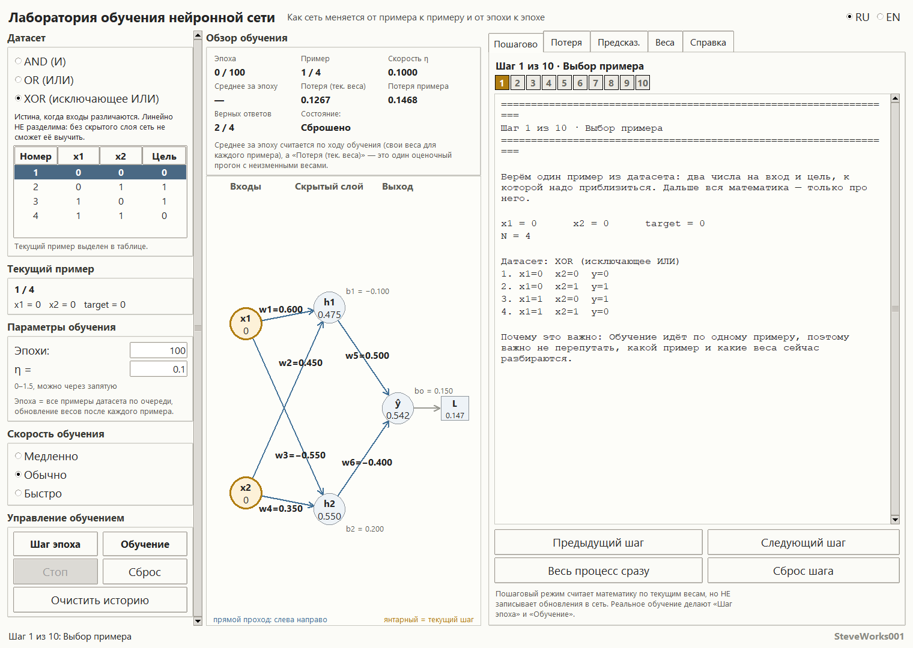
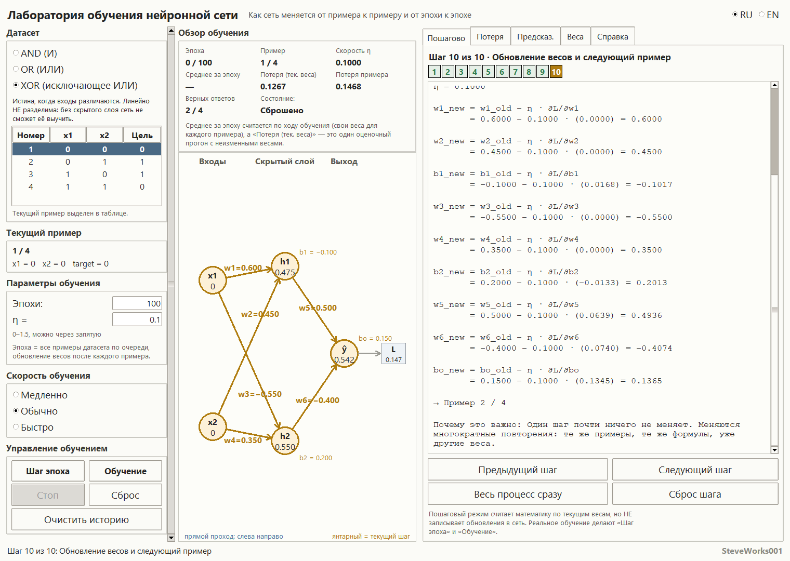
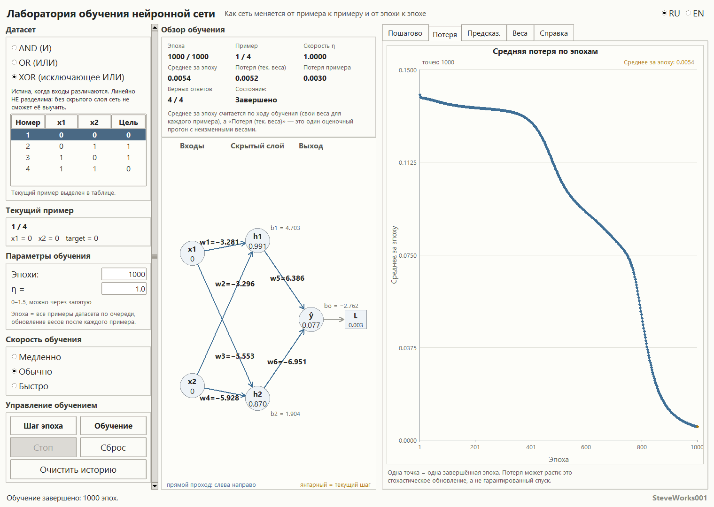
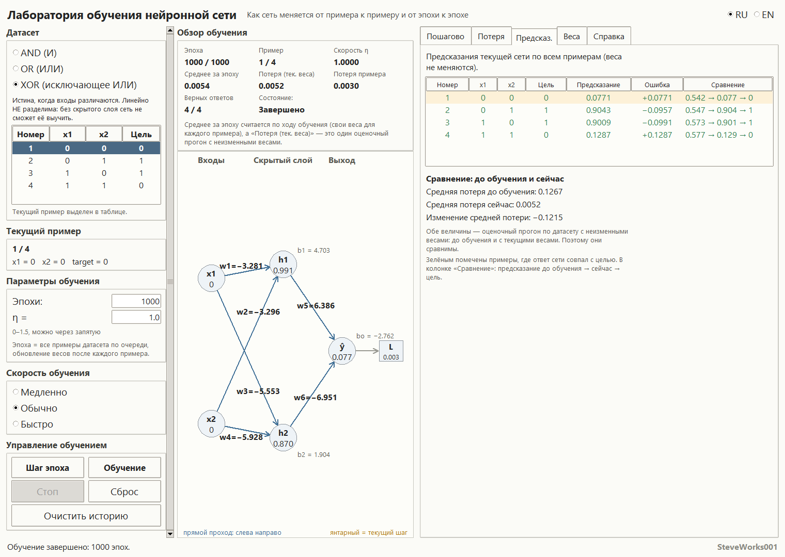
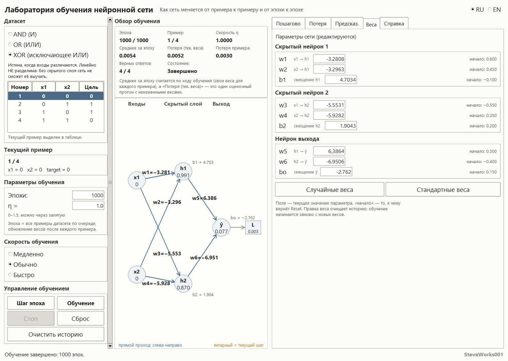
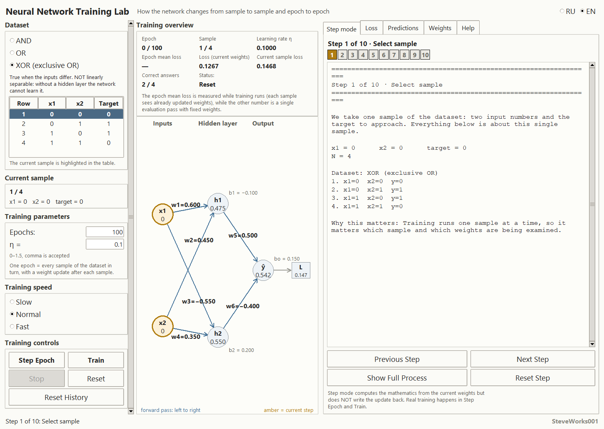
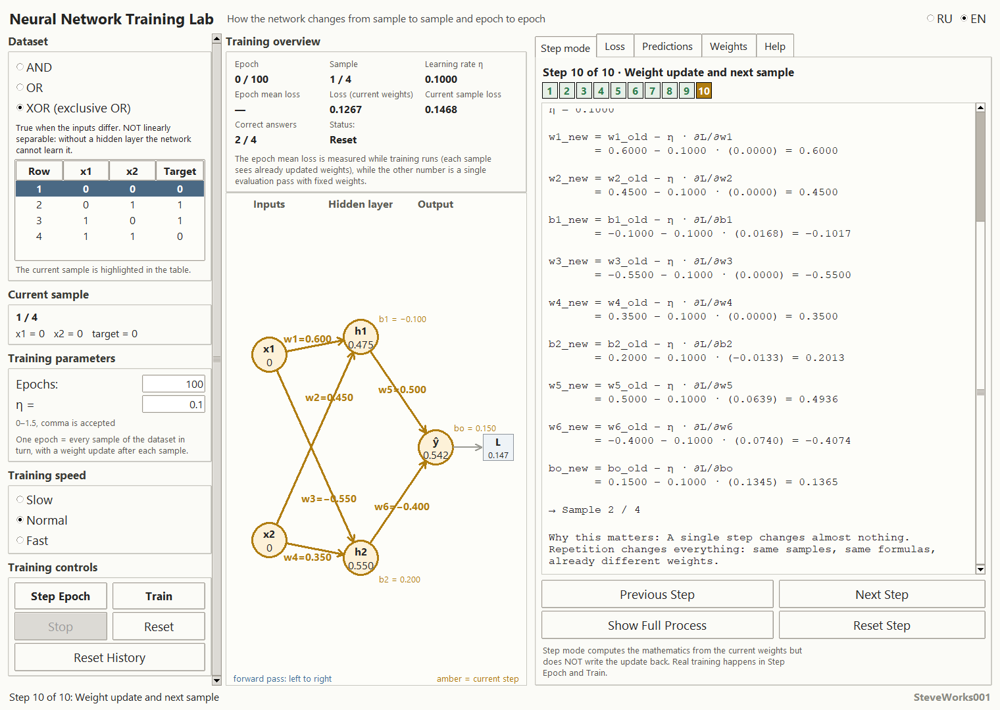
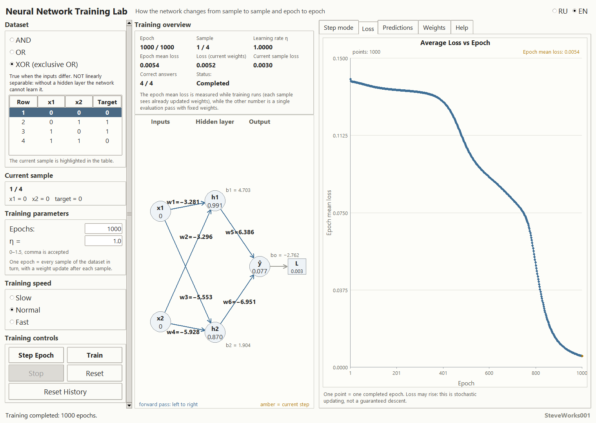
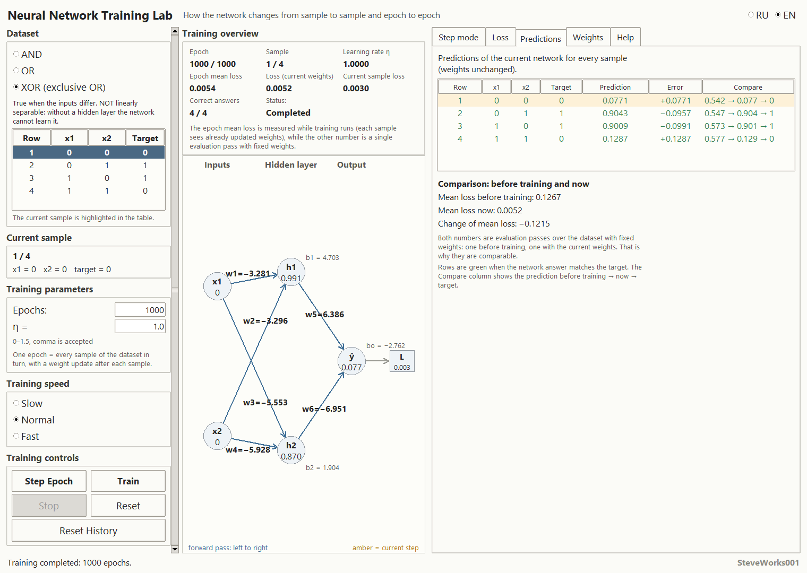
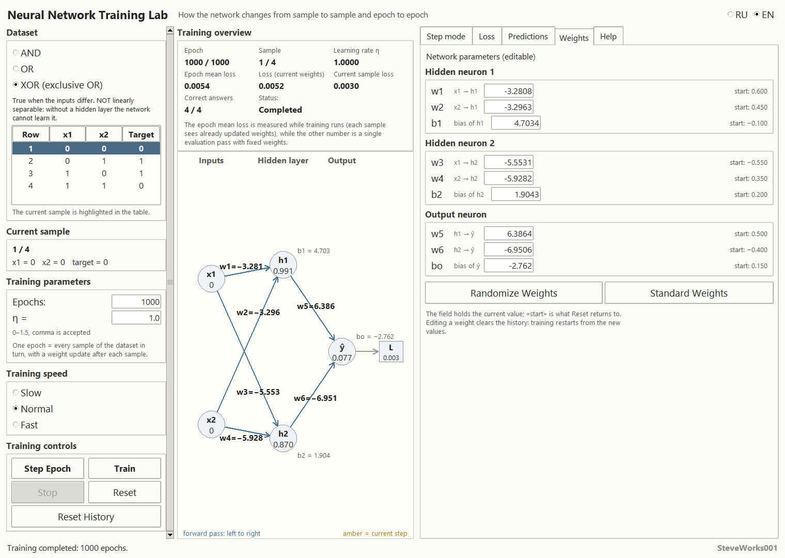

# Лаборатория обучения нейронной сети

Проект 6 из 13 серии учебных симуляторов нейронных сетей.
Однофайловое приложение на Python и Tkinter: только стандартная библиотека,
без внешних пакетов, без сети и без установки зависимостей.
Один и тот же цикл «прямой проход → потеря → обратный проход → обновление»
показан здесь сразу в трёх видах: числами на экране, разбором одного примера
по десяти шагам и графиком средней потери по эпохам.

---

## Назначение

Показать, как именно меняются веса нейросети, когда обучение повторяется
снова и снова, — без магии и без «чёрного ящика». Пользователь видит каждый
шаг: какое число откуда взялось, какая формула его произвела и как оно влияет
на следующий шаг.

Предыдущий проект серии разбирает один шаг обучения до единой цифры. Здесь
тот же шаг становится циклом: четыре примера, четыре обновления, одна точка
графика, затем ещё сто таких же эпох — и по экрану видно, что из этого
получилось.

Отдельная цель — научить различать величины, которые часто путают: потерю
одного примера, среднюю потерю по ходу эпохи и потерю одного оценочного
прогона с неизменными весами. Сравнение на «Предсказ.» строят только по
последней из них, и приложение прямо пишет об этом на экране.

### Чего в этом проекте нет

- нет настраиваемой модели: архитектура 2 → 2 → 1, сигмоида и квадратичная
  потеря фиксированы, другой слой или другая функция потерь не задаются;
- нет своих данных: три готовые таблицы по четыре примера, произвольный
  датасет не загружается и не добавляется;
- нет других методов оптимизации: только последовательный градиентный спуск,
  без мини-пакетов, инерции, адаптивных скоростей и регуляризации;
- нет разбиения на обучающую и проверочную выборки, нет валидации и подбора
  гиперпараметров;
- нет сохранения весов, экспорта графика, работы с файлами и логами;
- нет NumPy, pandas, SciPy, matplotlib, Pillow, TensorFlow, PyTorch, Keras,
  scikit-learn и любых пакетов из `pip`.

## Учебные цели

- Видеть весь цикл обучения как повторяющуюся последовательность из пяти
  действий, а не как невидимую работу обучающего вызова.
- Понять, почему эпоха из четырёх примеров — это ровно четыре обновления
  весов, а не одно.
- Различать потерю примера, среднее за эпоху и потерю оценочного прогона с
  неизменными весами — и понимать, какие из них сравнимы между собой.
- Читать градиенты всех девяти параметров и по их знаку предсказывать, куда
  сдвинется каждый вес.
- Понять, зачем нужен скрытый слой: AND и OR линейно разделимы, XOR — нет.
- Увидеть на графике, что потеря не обязана убывать ни по примерам, ни по
  эпохам: это нормальное поведение стохастического обновления.
- Понять роль начальных весов и скорости обучения: при одних настройках XOR
  выучивается, при других сеть зависает навечно с двумя верными ответами из
  четырёх.
- Научиться читать таблицу предсказаний: числовое значение ответа, порог
  классификации и признак верного ответа — три разные вещи.

## Математика: обучение сети 2 → 2 → 1

### Сеть и её девять параметров

```
x1 ──w1──▶ h1 ──w5──▶ ŷ ──▶ L
x2 ──w3──▶ h2 ──w6──▶ ↗
        (плюс смещения b1, b2, bo)
```

* два входа (`x1`, `x2`), значения 0 или 1;
* скрытый слой из двух нейронов (`h1`, `h2`);
* один нейрон выхода (`ŷ`), ответ от 0 до 1;
* скрытый слой обязателен: без него XOR неразделим.

| Параметр | Что делает |
| --- | --- |
| `w1`, `w2` | входы `x1`, `x2` → нейрон `h1` |
| `b1` | смещение `h1` |
| `w3`, `w4` | входы `x1`, `x2` → нейрон `h2` |
| `b2` | смещение `h2` |
| `w5`, `w6` | `h1`, `h2` → выход |
| `bo` | смещение выхода |

Все девять редактируются вручную, все девять обновляются обучением и все
девять появляются в каждом разборе шага.

### Активация — сигмоида

```
σ(z) = 1 / (1 + e^(−z))
σ'(z) = σ(z)·(1 − σ(z))
```

Сигмоида сжимает любое число в диапазон от 0 до 1, а её производная
выражается через уже посчитанное значение — поэтому одно и то же число
служит и ответом нейрона, и множителем в цепном правиле. Реализация
численно устойчивая: показательная функция вызывается только от
неположительного аргумента, так что переполнения нет даже при `|z| ≈ 1000` —
функция просто даёт 0.0 или 1.0.

### Прямой проход

```
z_h1 = x1·w1 + x2·w2 + b1        h1 = σ(z_h1)
z_h2 = x1·w3 + x2·w4 + b2        h2 = σ(z_h2)
z_o  = h1·w5 + h2·w6 + bo        ŷ  = σ(z_o)
```

Все промежуточные величины (`z_h1`, `h1`, `z_h2`, `h2`, `z_o`, `ŷ`)
показаны на схеме сети и в пошаговом разборе: именно они нужны, чтобы
объяснить следующую цифру.

### Потеря: одна формула, три разных числа

Для одного примера:

```
L = ½ · (ŷ − y)²
```

Множитель ½ нужен затем, чтобы при дифференцировании квадрата двойка
сократилась и производная вышла без лишнего коэффициента.

На экране под одним и тем же словом «потеря» живут три разных числа, и каждое
из них подписано отдельно:

* **Потеря примера** — `L` для одного текущего примера;
* **Среднее за эпоху** — среднее арифметическое потерь, каждая из которых
  посчитана своими, уже обновлёнными весами: «как сеть видела датасет в ходе
  эпохи»;
* **Потеря (тек. веса)** — одна средняя потеря по всему датасету при
  неизменных текущих весах, то есть результат оценочного прогона.

Сравнение «до и после» в приложении построено на числе «Потеря (тек. веса)»:
одна и та же величина, посчитанная сначала на стартовых весах, а потом на
текущих. Оба раза это оценочный прогон с неизменными весами, поэтому числа
корректно вычитать друг из друга. «Среднее за эпоху» — величина другого типа:
она смотрит на датасет сквозь веса, которые меняются прямо во время прохода, и
сопоставлять его с «до/после» напрямую нельзя. Приложение напоминает об этом
подписью под блоком обзора.

### Обратный проход

Цепочка производных идёт справа налево:

```
∂L/∂ŷ = ŷ − y
∂ŷ/∂z_o = σ'(z_o) = ŷ(1 − ŷ)
∂L/∂z_o = ∂L/∂ŷ · ∂ŷ/∂z_o                        # дельта выхода δ_o
∂L/∂w5 = ∂L/∂z_o · h1,  ∂L/∂w6 = ∂L/∂z_o · h2,  ∂L/∂bo = ∂L/∂z_o
∂L/∂h1 = ∂L/∂z_o · w5,  ∂L/∂h2 = ∂L/∂z_o · w6
∂L/∂z_h1 = ∂L/∂h1 · σ'(z_h1),  ∂L/∂z_h2 = ∂L/∂h2 · σ'(z_h2)   # δ_h1, δ_h2
∂L/∂w1 = ∂L/∂z_h1 · x1, ∂L/∂w2 = ∂L/∂z_h1 · x2, ∂L/∂b1 = ∂L/∂z_h1
∂L/∂w3 = ∂L/∂z_h2 · x1, ∂L/∂w4 = ∂L/∂z_h2 · x2, ∂L/∂b2 = ∂L/∂z_h2
```

Из двух дельт скрытого слоя и одной дельты выхода получаются все девять
производных. Смещению соответствует множитель 1: оно входит в сумму без
коэффициента, поэтому его градиент равен дельте этого же нейрона.

### Обновление: одно правило для девяти параметров

```
новое = старое − η · ∂L/∂p
```

Обновление последовательное (стохастический градиентный спуск): веса
меняются сразу после каждого примера, а не после всей эпохи. Для датасета из
четырёх примеров одна эпоха — это четыре обновления, и второй пример уже
проходит через изменённую сеть.

### Один пример целиком на числах

Разбор, который показывает вкладка «Пошагово»: датасет XOR, пример № 4
(`x1 = 1, x2 = 1, цель = 0`), стартовые веса и `η = 0.1000`.

Прямой проход:

```
z_h1 = 1·0.6000 + 1·0.4500 − 0.1000 = 0.9500      h1 = σ(0.9500) = 0.7211
z_h2 = −1·0.5500 + 1·0.3500 + 0.2000 = 0.0000     h2 = σ(0.0000) = 0.5000
z_o  = 0.7211·0.5000 − 0.5000·0.4000 + 0.1500
       = 0.3106                                    ŷ = σ(0.3106) = 0.5770
```

Потеря примера:

```
L = 1/2·(0.5770 − 0)² = 0.1665
```

Обратный проход:

```
∂L/∂ŷ = 0.5770 − 0 = 0.5770
∂ŷ/∂z_o = 0.5770·(1 − 0.5770) = 0.2441
δ_o = 0.5770 · 0.2441 = 0.1408

∂L/∂w5 = 0.1408 · 0.7211 = 0.1016
∂L/∂w6 = 0.1408 · 0.5000 = 0.0704
∂L/∂bo = 0.1408

∂L/∂h1 = 0.1408 · 0.5000 = 0.0704      σ'(z_h1) = 0.7211·(1 − 0.7211) = 0.2011
δ_h1 = 0.0704 · 0.2011 = 0.0142

∂L/∂h2 = 0.1408 · (−0.4000) = −0.0563  σ'(z_h2) = 0.5000·(1 − 0.5000) = 0.2500
δ_h2 = −0.0563 · 0.2500 = −0.0141

∂L/∂w1 = ∂L/∂w2 = ∂L/∂b1 = 0.0142
∂L/∂w3 = ∂L/∂w4 = ∂L/∂b2 = −0.0141
```

Обновление:

| Параметр | Было | Градиент | Стало |
| --- | --- | --- | --- |
| `w1` | 0.6000 | 0.0142 | 0.5986 |
| `w2` | 0.4500 | 0.0142 | 0.4486 |
| `b1` | −0.1000 | 0.0142 | −0.1014 |
| `w3` | −0.5500 | −0.0141 | −0.5486 |
| `w4` | 0.3500 | −0.0141 | 0.3514 |
| `b2` | 0.2000 | −0.0141 | 0.2014 |
| `w5` | 0.5000 | 0.1016 | 0.4898 |
| `w6` | −0.4000 | 0.0704 | −0.4070 |
| `bo` | 0.1500 | 0.1408 | 0.1359 |

Знак градиента и есть направление: при положительном градиенте вес
уменьшается, при отрицательном — растёт.

Полезная наблюдательность: на примере № 1 (`x1 = 0, x2 = 0`) градиенты всех
четырёх весов скрытого слоя равны ровно нулю — входной множитель обнуляет
произведение. Не двигаются только те веса, чей вход равен нулю; смещения при
этом меняются, потому что их множитель — единица.

### Одна эпоха на тех же весах

Эпоха проходит датасет по порядку строк, и потеря каждого примера считается
до обновления по этому примеру:

| Пример | x1, x2 → цель | Потеря |
| --- | --- | --- |
| 1 | 0, 0 → 0 | 0.1468 |
| 2 | 0, 1 → 1 | 0.1050 |
| 3 | 1, 0 → 1 | 0.0912 |
| 4 | 1, 1 → 0 | 0.1687 |

Среднее за эпоху — 0.1279. Потери второго, третьего и четвёртого примеров
получены уже новыми весами, поэтому четвёртая цифра больше, чем та же потеря
этого примера на стартовых весах (0.1665). Это и есть разница между «как сеть
видела датасет в ходе эпохи» и одним оценочным прогоном: средняя потеря при
неизменных весах до эпохи 0.1267, после эпохи 0.1265.

### Что сеть учит: AND, OR, XOR

| Датасет | Примеры (x1, x2 → y) | Свойство |
| --- | --- | --- |
| AND | 00→0, 01→0, 10→0, 11→1 | линейно разделим |
| OR | 00→0, 01→1, 10→1, 11→1 | линейно разделим |
| XOR | 00→0, 01→1, 10→1, 11→0 | линейно НЕ разделим |

AND: истина только когда оба входа равны 1. OR: истина, если хотя бы один вход
равен 1. XOR: истина, когда входы различаются, — и без скрытого слоя такая
задача неподъёмна. Скрытых нейронов ровно два, и при одинаковых весах они
схлопываются в один: поэтому стартовый набор весов намеренно несимметричен.

## Интерфейс и как пользоваться

Экран разделён на три колонки и нижнюю строку состояния. Слева — переключатель
датасета, текущий пример, параметры обучения, скорость и кнопки управления. В
центре — блок «Обзор обучения» из восьми ячеек и схема сети. Справа — пять
вкладок: «Пошагово», «Потеря», «Предсказ.», «Веса», «Справка».

### Левая колонка

* **Датасет** — три переключателя (`AND (И)`, `OR (ИЛИ)`,
  `XOR (исключающее ИЛИ)`), под ними описание выбранной таблицы и сами четыре
  строки с целями; текущий пример в таблице подсвечен.
* **Текущий пример** — номер примера в эпохе и его `x1`, `x2`, цель.
* **Параметры обучения** — поле «Эпохи» (1–10000) и поле «Скорость η»
  (0–1.5, допускается запись через запятую), плюс подпись о том, что такое
  эпоха.
* **Скорость обучения** — три режима: «Медленно» (1 эпоха на отметку, пауза
  120 мс), «Обычно» (3 эпохи, 30 мс), «Быстро» (20 эпох без паузы). Скорость
  меняет только темп обновления экрана, но не математику: одна и та же
  последовательность шагов даёт один и тот же результат.
* **Управление обучением** — «Шаг эпоха», «Обучение», «Стоп», «Сброс»,
  «Очистить историю».

### Центр: обзор и схема сети

Восемь ячеек обзора: «Эпоха» (счётчик вида `текущая / запланированная`),
«Пример», «Скорость η», «Среднее за эпоху», «Потеря (тек. веса)», «Потеря
примера», «Верных ответов» и «Состояние». Под ними — предупреждение о том, что
среднее за эпоху считается по ходу обучения, а «Потеря (тек. веса)» — это один
оценочный прогон с неизменными весами.

Схема сети показывает узлы `x1`, `x2`, `h1`, `h2`, `ŷ` и `L`: внутри узлов —
текущие значения, на рёбрах — веса, рядом с нейронами — смещения. Подпись под
схемой меняет направление: «прямой проход: слева направо» (синим) и «обратный
проход: справа налево» (красным), плюс пометка «янтарный = текущий шаг».
Числа на схеме обновляются после каждого обновления весов и не прячутся ради
аккуратного вида.

### Движение по эпохам

* **«Шаг эпоха»** — ровно одна эпоха: четыре примера, четыре обновления, одна
  точка истории, одно число «Среднее за эпоху». Это главный режим: он даёт
  посмотреть на результат каждого прохода до того, как цикл пойдёт дальше.
* **«Обучение»** — запускает цикл на запланированное число эпох. Цикл
  неблокирующий: окно можно двигать, переключать язык и вкладки прямо во время
  обучения. По достижении плана состояние становится «Завершено».
* **«Стоп»** — останавливает цикл, состояние «Остановлено». Веса и история
  остаются такими, какими их застал стоп.
* **«Сброс»** — возвращает сеть к начальным параметрам, обнуляет эпохи и
  очищает историю.
* **«Очистить историю»** — убирает только точки графика и сбрасывает счётчик
  эпох; текущие веса не меняются. Нужно, чтобы начать новый график от уже
  имеющейся сети. У этого есть последствие: та же кнопка пересчитывает точку
  отсчёта на вкладке «Предсказ.», поэтому «Средняя потеря до обучения»
  становится равна «Средняя потеря сейчас», и сравнить сеть с её состоянием до
  первого обучения уже нельзя. Ручная правка любого веса даёт тот же эффект.
  Исходный отсчёт возвращает только «Сброс» (или смена датасета): он ставит
  обратно начальные веса.

Во время идущего автоматического обучения кнопка «Шаг эпоха» не действует:
появляется сообщение «Сначала нажмите „Стоп“: идёт автоматическое обучение.».
Ручная правка любого веса тоже очищает историю — обучение начинается заново с
новых весов. Смена датасета начинает обучение заново: история и счётчик
эпох очищаются, а веса возвращаются к начальным.

### Пошаговый режим

Вкладка «Пошагово» разбивает один пример на десять шагов:

1. Выбор примера
2. Первый скрытый нейрон
3. Второй скрытый нейрон
4. Выход и предсказание
5. Потеря примера
6. Обратный проход: выход
7. Градиенты выходного слоя
8. Обратный проход: скрытый слой
9. Градиенты скрытого слоя
10. Обновление весов и следующий пример

Над кнопками — десять пронумерованных клеток: текущая подсвечена, на любую
можно перейти щелчком. Кнопки: «Предыдущий шаг», «Следующий шаг», «Весь процесс
сразу», «Сброс шага». Каждый шаг даёт формулу, подстановку настоящих чисел и
результат, а также пояснение «Почему это важно»; на схеме сети в этот момент
янтарным подсвечен разбираемый узел или ребро.

**Важно:** пошаговый режим ничего не записывает в сеть. Он считает математику
по текущим весам, поэтому кнопками шагов можно ходить многократно. Значения
обновления в шаге 10 показаны, но не применяются — реальное обучение делают
«Шаг эпоха» и «Обучение».

### График потерь

Вкладка «Потеря» — график средней потери по эпохам, построенный прямо в окне:

* одна точка = одна завершённая эпоха, точки соединены линией, последняя
  выделена янтарным;
* ось вертикали — «Среднее за эпоху», ось горизонтали — «Эпоха», деления
  подписаны числами, шкала подбирается по данным;
* над полем — заголовок, число точек и текущее среднее;
* при пустой истории вместо графика — подпись «Истории пока нет. Нажмите
  „Шаг эпоха“ или „Обучение“»;
* при очень длинной истории точки прореживаются, но последняя эпоха всегда
  остаётся на рисунке.

Подпись под графиком напоминает: потеря может расти — это стохастическое
обновление, а не гарантированный спуск.

### Таблица предсказаний

Вкладка «Предсказ.» показывает оценочный прогон по всем примерам (веса не
меняются): «Номер», `x1`, `x2`, «Цель», «Предсказание», «Ошибка», «Сравнение».
Порог классификации — 0.5; ошибка равна «предсказание − цель»; строки, где
ответ сети совпал с целью, помечены зелёным, а текущий пример подсвечен. В
колонке «Сравнение» — `до обучения → сейчас → цель`.

Под таблицей — блок сравнения: «Средняя потеря до обучения», «Средняя потеря
сейчас», «Изменение средней потери» и строка «Верных ответов: было N из 4,
стало M из 4». Отдельная оговорка объясняет, почему эти два числа сравнимы:
оба — оценочный прогон по датасету с неизменными весами.

### Панель параметров сети

Вкладка «Веса» — девять редактируемых полей, сгруппированных по нейронам
(«Скрытый нейрон 1», «Скрытый нейрон 2», «Нейрон выхода»). У каждого поля —
подсказка назначения (`x1 → h1`, `смещение h1` и так далее) и значение
«начало» — то, к чему вернёт «Сброс».

* **«Случайные веса»** — равномерные значения от −0.5 до +0.5; каждое нажатие
  даёт новый набор, повторить такой же результат невозможно;
* **«Стандартные веса»** — фиксированный стартовый набор
  `w1=0.60, w2=0.45, b1=−0.10, w3=−0.55, w4=0.35, b2=0.20, w5=0.50, w6=−0.40, bo=0.15`.
  Он асимметричен именно для того, чтобы два скрытых нейрона не схлопнулись в
  один.

### Справка

Вкладка «Справка» — выпадающий список из десяти разделов и поле текста:
что такое обучение сети, датасет, прямой проход, предсказание, потеря,
обратное распространение, градиент, обновление весов, эпоха и скорость
обучения.

### Поля и пределы

* **Эпохи** — целое от 1 до 10000;
* **η** — от 0 до 1.5, `0,1` и `0.1` одинаковы;
* **девять параметров сети** — от −5 до +5.

Некорректный ввод не роняет приложение. Число приводится к ближайшему
допустимому, поле подсвечивается, а в статусной строке появляется сообщение
про допустимый диапазон — и в поле сразу видно итоговое число, а не введённое.

### Язык

Интерфейс полностью переключается на ходу, без перезапуска: подписи,
пояснения шагов, тексты справки, статусы и сообщения о некорректном вводе.
Переключатель RU/EN — в правом верхнем углу, а переключение языка не трогает
состояние обучения: эпохи, веса, история, разбор шага и выбранная вкладка
сохраняются.

Формулы не переводятся — математика в обоих языках одинакова. Три подписи над
числами-потерями переведены строго друг к другу, поэтому одно и то же
обучение можно разобрать в любом языке и получить те же числа.

## Что происходит при разных η и разных начальных весах

Ниже — результаты, полученные самим приложением при стандартном наборе весов.
Первые три таблицы воспроизводятся точно: порядок примеров в эпохе фиксирован
(по строкам таблицы), перемешивания в обучении нет, а `random` используется
только кнопкой «Случайные веса» — при тех же стартовых весах, `η` и числе эпох
приложение выдаёт те же цифры. Последняя таблица — образец, а не гарантия: там
десять разных случайных инициализаций, и её результат зависит от начальных
весов.

При значениях по умолчанию (XOR, `η = 0.1`, 100 эпох) сеть **не** решает XOR:

| Датасет | η | Эпохи | Средняя потеря | Верных ответов | Предсказания после обучения |
| --- | --- | --- | --- | --- | --- |
| XOR | 0.1 | 100 | 0.1267 → 0.1249 | 2 → 2 | 0.485, 0.487, 0.516, 0.516 |
| AND | 0.1 | 100 | 0.1376 → 0.0899 | 1 → 3 | 0.261, 0.260, 0.301, 0.298 |
| OR | 0.1 | 100 | 0.1074 → 0.0851 | 3 → 3 | 0.705, 0.735, 0.752, 0.772 |

Все четыре ответа лежат около 0.5 — сеть «не решила», а скорее засомневалась.
Линейно разделимые задачи сдвигаются заметнее, но и им не хватает 100 эпох при
малой `η`:

| Датасет | η | Эпохи | Средняя потеря | Эпоха, где впервые 4 из 4 |
| --- | --- | --- | --- | --- |
| AND | 0.3 | 200 | 0.1376 → 0.0543 | 200 |
| AND | 0.5 | 200 | 0.1376 → 0.0236 | 118 |
| OR | 0.3 | 200 | 0.1074 → 0.0384 | 174 |
| OR | 0.5 | 200 | 0.1074 → 0.0123 | 107 |

XOR требует и большей скорости, и порядком больше эпох:

| η | Эпохи | Эпоха, где впервые 4 из 4 | Средняя потеря после этого |
| --- | --- | --- | --- |
| 0.3 | 2000 | 1768 | 0.0266 |
| 0.5 | 2000 | 1926 | 0.0368 |
| 0.8 | 2000 | 1015 | 0.0011 |
| 1.0 | 2000 | 774 | 0.0006 |
| 1.2 | 2000 | 627 | 0.0005 |

Три вывода:

* малая `η` при 100 эпохах даёт почти незаметный сдвиг — кривая на графике
  выглядит чуть наклонной, а верных ответов остаётся 2 из 4;
* увеличение числа эпох помогает, но медленно: XOR живёт в другой шкале, чем
  AND и OR;
* бо́льшая `η` ускоряет сходимость, но именно при ней легче всего увидеть
  колебания и расходимость — рост потерь на графике.

Случайные веса делают картину ещё честнее. Десять запусков XOR по 2000 эпох:

| η | Достигли 4 из 4 | Остались ниже |
| --- | --- | --- |
| 1.0 | 9 запусков, эпохи от 444 до 1137 | 1 запуск: 3 из 4 |
| 0.5 | 6 запусков, эпохи от 1143 до 1915 | 4 запуска: 2–3 из 4 |

Так что «XOR выучился» — это свойство конкретной пары «начальные веса и η», а
не свойство метода.

## Скриншоты

Все кадры получены из запущенного приложения (Python 3.12, Windows), размер окна
1520 × 1080 px. Левая колонка интерфейса прокручивается, и при стандартной высоте
940 px кнопки «Шаг эпоха» и «Обучение» не помещаются целиком, поэтому для съёмки
окно было сделано выше стандартного.

### Русский интерфейс

Главное окно: датасет XOR, состояние до обучения — «Эпоха» 0 / 100, «Потеря
(тек. веса)» 0.1267, «Потеря примера» 0.1468, «Верных ответов» 2 / 4, «Состояние:
Сброшено».



Пошаговый режим, шаг 10 из 10 — «Обновление весов и следующий пример»: девять
формул вида `w_new = w_old − η · ∂L/∂w` и строка `→ Пример 2 / 4`. Текстовая
панель прокручена в конец, поэтому верхняя строка видна не полностью.



Вкладка «Потеря» после 1000 эпох с η = 1.0: кривая средней потери по эпохам,
«точек: 1000», «Среднее за эпоху» 0.0054, «Верных ответов» 4 / 4.



Вкладка «Предсказ.»: предсказания 0.0771 / 0.9043 / 0.9009 / 0.1287 и блок
«Сравнение: до обучения и сейчас» — 0.1267 → 0.0052, изменение −0.1215.



Вкладка «Веса»: девять обученных параметров (w1 = −3.2808, w2 = −3.2963,
b1 = 4.7034, w3 = −5.5531, w4 = −5.9282, b2 = 1.9043, w5 = 6.3864, w6 = −6.9506,
bo = −2.762) рядом с их начальными значениями.



### English interface

Those same five states in the English locale, captured from the same run of the
same build.











---

## Учебные опыты

Все числа ниже — из расчёта самого приложения при стандартном наборе весов, и
они воспроизводимы: порядок примеров в эпохе фиксирован, перемешивания в
обучении нет, а `random` используется только кнопкой «Случайные веса».

**1. Одна эпоха — и три разных числа потери.** Датасет XOR, «Стандартные
весы», `η = 0.1`. Запомните значение «Потеря (тек. веса)» в обзоре, затем
нажмите «Шаг эпоха» ровно один раз.
Наблюдайте: до нажатия «Потеря (тек. веса)» равна 0.1267, поле «Среднее за
эпоху» пустое (—), а «Потеря примера» показывает 0.1468; после одного нажатия
«Среднее за эпоху» — 0.1279, «Потеря (тек. веса)» — 0.1265, «Верных ответов»
по-прежнему 2 / 4, а «Потеря примера» — 0.1687 только при выбранном примере 4.
О чём подумать: 0.1279 — среднее четырёх потерь, каждая из которых посчитана
своими весами (таблица «Одна эпоха на тех же весах»), а 0.1265 — один прогон с
неизменными весами; какая из этих величин отвечает на вопрос «стало ли лучше»
и почему это не одно и то же число.

**2. `η = 0`: цикл крутится, чисел не меняется.** `η = 0`, 50 эпох, кнопка
«Обучение».
Наблюдайте: на графике 50 точек на одном уровне 0.1267, «Среднее за эпоху» и
«Потеря (тек. веса)» совпали, все девять полей на вкладке «Веса» остались
стартовыми, предсказания — 0.5418, 0.5473, 0.5734, 0.5770, и «Верных
ответов» 2 / 4.
О чём подумать: правило `новое = старое − η · ∂L/∂p` при `η = 0` обнуляет все
девять приращений — и именно поэтому среднее за эпоху стало равно оценочной
потере, хотя в опыте 1 эти два числа разошлись.

**3. «Очистить историю» стирает точку отсчёта.** `η = 0.1`, 100 эпох —
кнопкой «Обучение» или сотней нажатий «Шаг эпоха», затем «Очистить историю».
Наблюдайте: до очистки сравнение на «Предсказ.» даёт 0.1267 и 0.1249 с изменением
−0.0018; сразу после очистки обе строки показывают 0.1249, счётчик эпох
вернулся к 0, график пуст; «Сброс» возвращает и 0.1267 как «до», и стартовые
веса.
О чём подумать: «Средняя потеря до обучения» — не память о самом начале, а
пересчёт по текущим весам; в какой момент слова «до обучения» перестают что-то
означать и чем «Очистить историю» отличается от «Сброса» по составу
возвращаемого состояния.

**4. Порог 0.5 и счётчик верных ответов.** Датасет AND, `η = 0.5`, 118 эпох,
затем продлите тот же прогон до 200.
Наблюдайте: ровно на 118-й эпохе «Верных ответов» становится 4 / 4, а
предсказания в этот момент — 0.1277, 0.2580, 0.3339, 0.5020: четвёртый пример
перешагнул порог с запасом в две тысячных. «Потеря (тек. веса)» здесь 0.0553,
а после 200 эпох — 0.0236 при тех же четырёх верных ответах.
О чём подумать: счётчик считает переходы через 0.5 и не видит уверенности
ответа; как потеря продолжает падать, когда «Верных ответов» уже максимум, — и
какое из этих двух чисел говорит о сети больше.

**5. Два одинаковых скрытых нейрона — это один нейрон.** «Стандартные веса»,
затем на вкладке «Веса» вручную: `w3 = 0.6`, `w4 = 0.45`, `b2 = −0.1`,
`w6 = 0.5`; датасет XOR, `η = 1.0`, 2000 эпох.
Наблюдайте: шаги 2 и 3 на вкладке «Пошагово» печатают для открытого примера
одинаковые `z` и `h`, и равенство держится весь прогон; за 2000 эпох «Верных
ответов» ни разу не стало 4 / 4 — остаётся 3 / 4, а сравнение на «Предсказ.» даёт
0.1407 → 0.0856. Для сравнения: при стандартных, несимметричных весах и той же
`η = 1.0` четыре верных ответа приходят на 774-й эпохе.
О чём подумать: два нейрона с одинаковыми весами дают один и тот же признак,
поэтому скрытый слой сжался фактически в один юнит; и почему этот опыт не
доказывает обратное — одна несимметрия весов ещё не гарантирует, что XOR
выучится.

## Установка и запуск

Приложение — один файл; сборки и установки зависимостей не требуется.

Windows:

```bash
python neural_network_training_lab.py
```

macOS и Linux:

```bash
python3 neural_network_training_lab.py
```

Аргументы командной строки не нужны. Быстрый старт: при запуске выбран
датасет XOR, `η = 0.1`, 100 эпох и стандартные веса — нажмите «Шаг эпоха»
несколько раз и смотрите, как меняются восемь ячеек обзора, а затем
переключитесь на «Пошагово» и разберите тот же цикл по числам.

Окно открывается по размеру экрана (примерно до 1520×940) и не уменьшается
примерно ниже 1300×768.

## Требования

- Python 3.8 или новее.
- Tkinter — входит в официальные сборки Python для Windows и macOS; в некоторых
  дистрибутивах Linux ставится отдельно как пакет `python3-tk`.
- Только стандартная библиотека: `math`, `random`, `tkinter`, `tkinter.ttk`,
  `tkinter.font`.
- Не используются: NumPy, pandas, SciPy, matplotlib, Pillow, TensorFlow,
  PyTorch, Keras, scikit-learn и любые пакеты из `pip`.
- Сетевое соединение для работы приложения не требуется.

## Ограничения

- **XOR не обязан сходиться.** Результат зависит от начальных весов и η. При
  значениях по умолчанию (100 эпох, `η = 0.1`) сеть остаётся на двух верных
  ответах из четырёх; при стандартных весах и `η ≈ 1.0` разделение появляется
  примерно на 600–1900-й эпохе; часть случайных инициализаций не решает XOR и
  за 2000 эпох. Гарантии сходимости приложение не даёт.
- **AND и OR тоже не решаются «сразу».** При `η = 0.1` и 100 эпохах верных
  ответов становится 3 из 4 (AND) или остаётся 3 из 4 (OR); чтобы увидеть все
  четыре, нужны десятки-сотни эпох при `η ≥ 0.3`.
- **Потеря не обязана убывать монотонно** — ни по отдельным примерам, ни по
  отдельным эпохам. Обновление последовательное, и рост — нормальное
  поведение, а не ошибка отображения.
- **Среднее за эпоху и потеря оценочного прогона — разные величины.** Их
  численные значения могут расходиться, и сравнивать «до» с «после» корректно
  только по оценочному прогону; приложение подчёркивает это на экране.
- **Большая η вредна.** Диапазон до 1.5 оставлен специально, чтобы были видны
  расходимость и колебания; это не «лучшее значение по умолчанию». `η = 0`
  означает «веса не меняются».
- **Случайные веса невоспроизводимы по умолчанию.** Каждое нажатие
  «Случайные веса» даёт новый набор, поэтому два одинаковых запуска обучения
  после него не обязательны.
- **Маленькая сеть и маленький датасет.** Один скрытый слой из двух нейронов,
  четыре примера, бинарные цели, значения входов 0 или 1. Это не масштабируется
  на реальные задачи.
- **Один метод обучения.** Только последовательный градиентный спуск: нет
  мини-пакетов, инерции, адаптивных скоростей, регуляризации, других функций
  активации, нескольких скрытых слоёв, разбиения на обучающую и проверочную
  выборки и валидации.
- **Числа выводятся с ограниченным числом знаков** (обычно 3–4), поэтому
  пересчёт «вручную» по экрану может разойтись с приложением в последних
  разрядах.
- **Пошаговый режим — снимок, а не обучение.** Он показывает, что *произошло
  бы*, и не изменяет сеть.
- **Только графический интерфейс.** Нет консольного режима, API, пакетного
  запуска, сохранения весов и экспорта графика; данные не читаются из файлов.
- **Это учебный симулятор, а не промышленный фреймворк машинного обучения.**
  Он нужен, чтобы понять один цикл обучения целиком, а не чтобы получить
  модель.

## Учебная оговорка

Симулятор показывает один механизм — повторяющийся цикл обучения крошечной
сети, — и часть соглашений выбрана ради наглядности. Обновление строго
последовательное: веса меняются после каждого из четырёх примеров, поэтому
одна эпоха даёт ровно четыре обновления, а «Среднее за эпоху» считается
из потерь, каждая из которых получена своими весами. Порог классификации 0.5
зафиксирован, а «верных ответов» — это число примеров, чей ответ перешёл
порог, а не мера качества. Функция потерь выбрана `½(ŷ − y)²`, а не
перекрёстная энтропия: производная такой записи короче и лучше читается в
пошаговом разборе. Скорость отрисовки («Медленно» / «Обычно» / «Быстро») не
влияет на арифметику — она меняет только то, как часто экран успевает
обновиться. Верхняя граница `η` равна 1.5 не потому, что такое значение
полезно, а потому, что за ней видно расходимость. Начальные веса по умолчанию
подобраны под наглядность, а не взяты из практики обучения моделей.

## Что нужно знать заранее

**Строго необходимо:** Python 3 с Tkinter и запуск одного файла из командной
строки. Пакеты из `pip`, сеть и внешние файлы не нужны.

**Математика:** производная как ответ на вопрос «насколько быстро меняется одно
число, когда меняется другое», и умение читать правило `новое = старое − η ·
∂L/∂p`. Все нужные производные — `σ′(z)`, `∂L/∂ŷ` и множители цепочки —
приложение печатает на экране отдельными числами, выводить их заново не
требуется. От проекта 5 отличается только количеством повторов: те же девять
параметров обновляются четыре раза за эпоху, а не один раз за разбор.

**Полезно, но не обязательно:** проект 5 «Обратное распространение» — тот же
обратный ход, но разобран на одном шаге; проект 4 «Градиентный спуск» — само
обновление одного параметра; проект 3 «Mini Neural Network» — прямой ход по той
же структуре 2 → 2 → 1; проект 2 «Перцептрон» — почему XOR без скрытого слоя
не решается.

**О версии Python:** раздел «Требования» называет Python 3.8 или новее.
Приложение версию не проверяет, а запуск на других версиях не тестировался —
это объявленная совместимость, а не проверенная гарантия.

## Место в серии

Проект 6 из 13. Порядок не строгий: каждый проект запускается сам по себе и
ничего не читает из соседних. Ниже только те связи, которые есть по содержанию.

| Проект | Связь по содержанию |
|---|---|
| 2 — Perceptron | там один нейрон не справляется с XOR; здесь появляется скрытый слой и ответ на вопрос, чем он платит за это |
| 3 — Mini Neural Network | тот же прямой ход 2 → 2 → 1 и те же девять чисел, но здесь они ещё и обновляются |
| 4 — Gradient Descent | правило `новое = старое − η · градиент`; здесь оно применяется четыре раза за эпоху |
| 5 — Backpropagation | один обратный ход, разобранный по шагам; здесь тот же ход повторяется циклом |
| 8 — Loss Functions | потеря зафиксирована как `½(ŷ − y)²`; при другой функции первым множителем цепочки было бы другое число |
| 9 — Classification | порог 0.5 и счётчик «верных ответов» здесь служебные; там они — предмет разговора |
| 11 — Optimizers | здесь чистый последовательный спуск; там то же обновление с инерцией и адаптивной скоростью |

Несоответствие, о котором стоит знать: служебный текст самого файла
(`neural_network_training_lab.py`, строки 3–6) описывает серию как
шестипроектную и называет этот проект «завершающим». Это внутренний docstring
программы, а не документация; нумерация в README ведётся по полной серии из 13
приложений. Исходный файл в рамках правки документации не менялся.

## Лицензия

Проект распространяется под лицензией [MIT License](LICENSE).

---

## Разработчик

**Разработчик: SteveWorks001**
